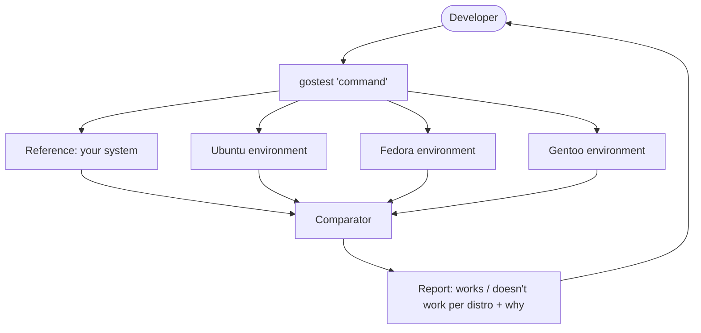

# gostest

> Test how shell commands and scripts behave across Linux distributions with a single command — and see *why* they fail when they do.

## The problem

When building a portable shell tool, the most common sentence you hear is: *"It works on your machine, but it doesn't work on distro X."*

The cause is rarely the logic of the code. It is the environment differences between distributions:

- `/bin/sh` may be a different shell: `dash` on Debian/Ubuntu, `bash` on Arch, `busybox ash` on Alpine
- Core tools have different implementations: GNU `grep`/`sed` and BusyBox support different flags
- Package names, versions and availability differ
- File paths and directory layouts differ

Today, a developer tests this by setting up a virtual machine per distribution, or by waiting for someone to say "it doesn't work here". Both are slow, and neither shows **why** it doesn't work.

## The solution

`gostest` runs the given command on your own system and, **in parallel**, inside isolated environments of the selected Linux distributions. It then **compares** every result with your system and reports the differences.

```bash
gostest "ani-cli -S 1 -e 1 'Vinland Saga'"
```



## Why "just running it" is not enough

Running a command in a few containers and looking at the exit code is misleading. The following script works correctly in bash:

```sh
name="ani-cli"
if [[ $name == ani* ]]; then echo "matched"; fi
```

| Environment | Output | Exit code |
|---|---|---|
| bash | `matched` | 0 |
| dash | `[[: not found` | **0** |

The script is broken under dash, yet the exit code is still 0. A tool that only checks exit codes calls both environments "successful". That is why `gostest` compares stdout, stderr **and** the exit code against the reference run.

## Workflow

1. The user provides a command: `gostest "command"`
2. The target distribution list is resolved (default list or configuration)
3. Required images are pulled and dependencies are installed with each distribution's own package manager (the result is cached)
4. The command is run on the user's own system. This run is the **reference**.
5. A container per distribution is started in parallel with goroutines (with a concurrency limit and a timeout)
6. The stdout, stderr and exit code of every environment are collected
7. The results are compared with the reference
8. Commands that are missing in a distribution but work on your system are installed automatically, and the command runs again there
9. PASS/FAIL and the differences are reported per distribution

## Use cases

- **Open source contributions:** check that a change doesn't break other distributions before sending a PR
- **Debugging:** reproduce an "it doesn't work on distro X" issue without installing that distribution
- **CI integration:** run the same tool in a CI environment such as GitHub Actions with the Docker backend

## Technical design

- **Language:** Go. It produces a single binary, and goroutines are a natural fit for parallel execution.
- **Isolation:** Docker/Podman containers. Containers share the host kernel, but their userland (shell, core tools, packages) really belongs to the given distribution — and that is the layer where most shell-script portability problems appear.
- **Backend abstraction:** the execution layer sits behind an interface. System container / VM backends such as Incus can be added later for scenarios that need systemd or a kernel.
- **Cache:** results are reused when nothing has changed. `--no-cache` re-runs everything.

## Scope and limits

- Only **Linux distributions** are targeted. macOS and Windows cannot be tested with containers.
- Actually opening GUI applications (e.g. video players), systemd/journald and kernel-dependent behaviour cannot be tested with the default Docker backend.
- The result of network-dependent commands may change with the current state of external services. This can cause result differences unrelated to environment differences.

## Installation

Requirements: Linux, Go 1.27+ to build, and Docker or Podman to run.

```bash
go install github.com/emre-tiryaki/gostest@latest
# or, from a checkout
make build        # produces ./gostest
```

## Usage

```bash
gostest [flags] [--] command [args...]
```

The command runs with `/bin/sh -c` on your machine (the reference) and in
every selected distribution. The working directory is mounted read-only into
the containers at the same path, so local scripts can be tested directly:

```bash
gostest ./install.sh                              # default distros
gostest -d alpine,ubuntu:22.04,fedora ./install.sh
gostest -p curl -p alpine=bash 'curl --version | head -1'
gostest --format json 'my-tool --version' > report.json
```

Example report:

```text
$ ./check.sh
reference: host, /bin/sh = bash, exit 0, 20ms

FAIL   alpine     /bin/sh = busybox ash  exit 2  268ms
       why:
         • `grep` here is the BusyBox implementation and does not support option `-P`
         • exit code 2, reference exited 0 (2 usually means a usage error or a misused shell builtin)
         • stdout differs from the reference
PASS   archlinux  /bin/sh = bash         exit 0  254ms
FAIL   debian     /bin/sh = dash         exit 0  296ms
       why:
         • `[[` is not available (here /bin/sh is dash, on the host it is bash): it is a bash/ksh feature, use [ ... ] or case instead
         • errors were printed but /bin/sh kept going and returned exit code 0 like the reference: checking the exit code alone would call this run a success
         • stdout differs from the reference
       stdout:
         - matched
           grep-ok
       stderr:
         + ./check.sh: 3: [[: not found
PASS   fedora     /bin/sh = bash         exit 0  400ms

2 passed, 2 failed, 0 errors
```

### Flags

| Flag | Description |
|---|---|
| `-d, --distros LIST` | Comma separated distributions. Default: `alpine,archlinux,debian,fedora,ubuntu`. Any distro accepts a tag: `ubuntu:22.04`. |
| `-p, --pkg SPEC` | Packages to install: `curl` (everywhere) or `alpine=bash` (one distro). Repeatable, comma separated. |
| `-j, --concurrency N` | Distributions processed at once. Default: number of CPUs. |
| `-t, --timeout DURATION` | Timeout of every run, `0` disables it. Default: `2m`. |
| `--ignore-stderr` | Compare only stdout and exit codes. |
| `--strict-order` | Fail when output has the same lines in a different order (by default this passes with a note). |
| `--engine NAME` | `docker` or `podman`. Default: auto-detect. |
| `--workdir DIR` | Working directory mounted into the containers. Default: current directory. |
| `--config FILE` | Configuration file. Default: nearest `.gostest.json`. |
| `--no-cache` | Ignore cached results and rebuild images. |
| `--no-auto-install` | Do not mount host tools or install missing commands automatically (see below); test the images as they are. |
| `--cleanup` | When the run ends, remove the images it pulled or built (see below). |
| `--clear-cache` | Remove cached results. |
| `--format FORMAT` | `text` or `json`. |
| `--color WHEN` | `auto`, `always` or `never`. `NO_COLOR` is honoured. |
| `--context N` | Unchanged lines shown around each change. Default: `3`. |
| `-v, --verbose` | Show the full output of every run. |
| `-q, --quiet` | Do not show progress. |
| `--list` | List the known distributions. |

Exit codes: `0` everything matches, `1` at least one distribution differs or
could not run, `2` invalid usage or configuration, `3` the reference or the
container engine could not run, `130` interrupted.

### Distributions

| Name | Image | Package manager | Default |
|---|---|---|---|
| alpine | `alpine:latest` | apk | ✓ |
| archlinux (`arch`) | `archlinux:latest` | pacman | ✓ |
| debian | `debian:latest` | apt | ✓ |
| fedora | `fedora:latest` | dnf | ✓ |
| ubuntu | `ubuntu:latest` | apt | ✓ |
| almalinux | `almalinux:latest` | dnf | |
| gentoo | `gentoo/stage3:latest` | emerge | |
| opensuse (`suse`) | `opensuse/tumbleweed:latest` | zypper | |

### Configuration

A `.gostest.json` in the working directory or any parent directory sets
project defaults. Command line flags take precedence.

```json
{
  "distros": ["alpine", "ubuntu:22.04", "fedora", "void"],
  "custom_distros": [
    {"name": "void", "image": "ghcr.io/void-linux/void-musl:latest", "package_manager": "apk"}
  ],
  "packages": ["curl", "alpine=bash", "fedora=which"],
  "concurrency": 4,
  "timeout": "90s",
  "engine": "docker",
  "ignore_stderr": false,
  "strict_order": false,
  "no_auto_install": false,
  "cleanup": false
}
```

### Missing commands

Base images are minimal, so a command that works on your machine (`jq`,
`curl`, `git` …) is often simply not installed in a container. By default
gostest installs it for you: when a distribution reports a command as not
found while the reference run did not, gostest builds an image on top of the
distribution's one in which its package manager installs a package providing
that command, then runs your command there again. Up to three rounds are
made, because an installed tool may need further commands. The report notes
what was installed:

```text
PASS   alpine     /bin/sh = busybox ash  exit 0  230ms
       note: installed automatically because they were missing here: `jq`
```

How a package is found depends on the package manager: Alpine and the
dnf/zypper distributions look up the package that provides the command
(`apk add cmd:jq`, `dnf install /usr/bin/jq`); apt, pacman and emerge try the
package with the same name as the command. When no package is found the
outcome says so and suggests `--pkg distro=<package>`, which is also the way
to install a package whose name differs from the command.

Shell keywords such as `[[`, paths and commands that are missing on the host
as well are never installed. The derived images are cached like the ones of
`--pkg`.

#### Host tools

Before installing anything, gostest checks whether the missing command is a
tool on your machine that can run anywhere: a script (a text file starting
with `#!`) or a statically linked binary. If so, that file (with symlinks
followed) is mounted read-only at `/usr/local/bin/<command>` and the command
runs again. Every distribution then runs **your** version of the tool, and
only the environment around it (shell, core tools, versions) differs:

```text
$ gostest 'ani-cli -V'
FAIL   alpine     /bin/sh = busybox ash  exit 1  374ms
       note: mounted from the host because they were missing here: `ani-cli`
       ...
         + Program curl not found
```

Host tools are tried first because a packaged version would make the
comparison with your machine meaningless. If the script's interpreter is
missing (`#!/bin/bash` or `#!/usr/bin/env bash` on Alpine), it is installed
in the next round as described above. Dynamically linked binaries are never mounted: they are
built against your machine's libc and libraries, so they would fail on musl
(Alpine) and give misleading results elsewhere; they go through the package
manager instead. Editing a mounted file invalidates the cached results that
used it.

Limits: only the file itself is mounted, so a script that sources files next
to it, or loads them from a `lib/` directory, fails in the containers. The
dependencies the tool checks for itself (such as `Program curl not found`)
are not installed automatically; add them with `--pkg`. A host path
containing `:` cannot be mounted. Scripts your distribution ships as part of
a package (e.g. `zgrep`) are also mounted when a target lacks them.

To test the images exactly as they are, pass `--no-auto-install` or set
`"no_auto_install": true`; this disables mounting host tools as well.

### Cleaning up

Containers are always removed as soon as their command finishes or times
out. The images stay, so the next run starts fast. With `--cleanup` (or
`"cleanup": true`), gostest removes them when the run ends, even after
Ctrl-C: every `gostest/...` image it built or reused (from `--pkg` and
automatic installation) and every base image it had to pull. Base images
that were already on your machine are kept. If an image cannot be removed,
for example because another container uses it, gostest prints a warning and
the exit code does not change.

### What gets explained

When a distribution differs from the reference, gostest looks at the new
stderr lines and the exit code and reports the likely cause:

- bash-only syntax and builtins under a POSIX `/bin/sh` (`[[`, `source`,
  `function`, `==` in `[`, `${var:0:3}`, arrays …), with POSIX alternatives
- missing commands (with a `--pkg` hint) and missing shebang interpreters
- options the local implementation of a tool does not support (GNU vs BusyBox)
- missing files, permission errors and writes to the read-only mount
- timeouts, signals and exit code meanings (126, 127, 128+n)
- *silent failures*: errors were printed but the exit code is still 0
- output that only differs in line order, with the host locale (see below)

### Locale and sort order

The environment of the host is not passed into the containers, so they run
with the `C` locale while your machine probably uses something like
`en_US.UTF-8`. Anything whose output depends on collation can then list the
same lines in a different order: `ls`, `sort`, glob expansion (`*`), `[a-z]`
ranges and so on. `en_US.UTF-8` sorts case insensitively, while `C` sorts by
byte value and puts uppercase names first.

By default a stream with the same lines (duplicates counted) in a different
order **matches**, and the outcome carries a note instead:

```text
$ gostest ls
PASS   debian  /bin/sh = dash  exit 0  241ms
       note: stdout has the same lines in a different order (host locale en_US.UTF-8, which the container does not inherit); --strict-order fails this
```

When the order is what you are testing (`sort` itself, scripts whose steps
must run in sequence), pass `--strict-order` or set `"strict_order": true`.
Reordered output then fails, and the report says that only the order differs
instead of a generic "stdout differs". To compare behaviour without the
locale, pin it in the command: `gostest 'LC_ALL=C ls'`.

### Caching

Images with installed packages are built once and tagged by a hash of the
base image and the package list. Results are cached in
`$XDG_CACHE_HOME/gostest` (override with `GOSTEST_CACHE_DIR`) and keyed by the
image ID, the command, the timeout and a fingerprint of the working directory,
so editing a script invalidates them. The reference always runs fresh.
`--no-cache` re-runs everything.

Working directories that would shadow system paths (`/`, `/usr/...`,
`/etc/...`, `/home` …) are mounted at `/work` instead of their host path.

## Development

```bash
make test          # all tests, including Docker integration tests
make test-short    # unit tests only, no container engine needed
make e2e           # end-to-end check of host tool mounting with temporary scripts
make lint          # gofmt + go vet
```

## Status

The project is at an early stage.

- [x] Run the command in several images in parallel with goroutines
- [x] Collect stdout, stderr and exit code
- [x] Reference run and comparison
- [x] Per-distro dependency installation and image cache
- [x] Result cache and `--no-cache`
- [x] Automatic installation of missing commands and `--no-auto-install`
- [x] Mounting missing host tools (scripts, static binaries) into the containers
- [x] `--cleanup` to remove the images of a run
- [x] Concurrency limit and timeout configuration
- [x] Detailed reporting that shows the cause of a difference

## Similar tools

- **ShellSpec:** a BDD test framework for POSIX shells. It supports Docker and CI, but requires writing test files.
- **Test Kitchen:** tests infrastructure code on multiple platforms. Focused on the Chef ecosystem.
- **distrobox:** lets you enter different distributions, but doesn't compare or report.

What sets `gostest` apart: it runs any command instantly on multiple distributions without writing test files, and shows the difference by comparing the result with a reference.
